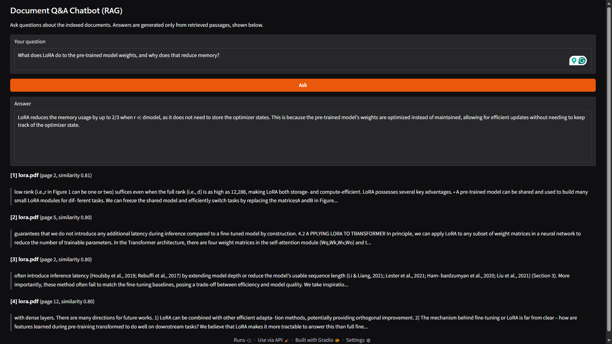
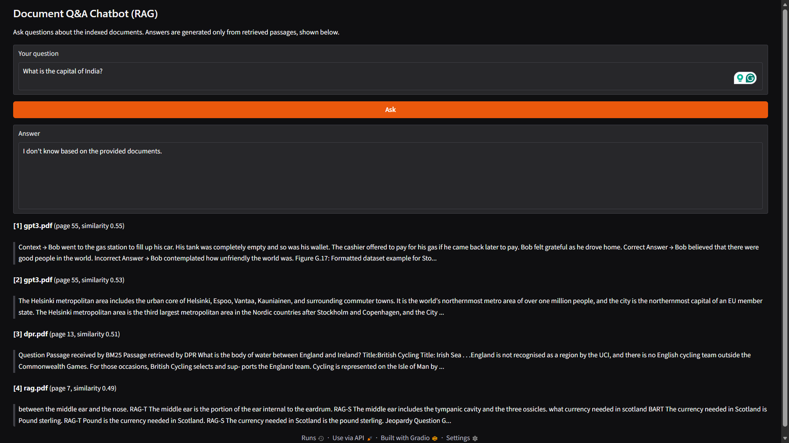

# Research-Paper Q&A Chatbot using Retrieval-Augmented Generation (RAG)

A question-answering chatbot over a corpus of **8 landmark AI papers** (Transformer, BERT, ViT, RAG, LoRA, GPT-3,
ResNet, DPR). It retrieves the most relevant passages, answers **only from them**, shows the source file and page for each
passage, and is instructed to say "I don't know" when the answer isn't in the documents. It runs entirely on open-source
models: no API key, no cost. A 30-question evaluation measures retrieval, answer accuracy and refusal behavior.

## Demo

| On-topic question: good retrieval, partly wrong answer | Off-topic question: correct refusal |
|---|---|
|  |  |

- **Left:** all four retrieved chunks come from the LoRA paper (similarity about 0.80), and the first one even says the
  shared model can be frozen. The answer's claim that memory use drops by up to 2/3 matches the paper, but its explanation
  that the pre-trained weights are "optimized instead of maintained" is wrong, because LoRA **freezes** them. This is a
  *generation* failure, not a retrieval failure (see the analysis below).
- **Right:** the bot correctly refuses an off-topic question. Note that the passages it retrieved are irrelevant
  (similarity 0.49-0.55); the pipeline always retrieves the top-k chunks, even when nothing relevant exists.

## How it works
```
 PDFs --> extract text per page --> chunk (200 words, 40 overlap) --> embed (BAAI/bge-small-en-v1.5) --> vector index
                                                                                                           |
 question --> embed --> top-k most similar chunks (cosine similarity) -----------------------------------+
                              |
                              v
        prompt = rules + numbered context + question --> Qwen2.5-0.5B-Instruct (local LLM) --> answer + cited sources
```
Retrieval uses cosine similarity over normalized embeddings (NumPy; FAISS is used instead if it is installed).

## Evaluation

30 hand-written questions: 24 answerable (3 per paper) and 6 unanswerable (off-topic). LLM: `Qwen/Qwen2.5-0.5B-Instruct`,
greedy decoding. Metrics:
- **Retrieval hit**: a retrieved chunk comes from the correct paper and contains a gold keyword.
- **Answer accuracy**: the generated answer contains a gold keyword (keyword matching, see caveats below).
- **Retrieved & correct**: both of the above. This is the closest measure to a *grounded* correct answer.
- **Abstention**: for unanswerable questions, the bot says it doesn't know.

| Configuration | Retrieval hit | Answer accuracy | Retrieved & correct | Abstention | Avg. time / question |
|---|---|---|---|---|---|
| top-k 2, 200-word chunks | 58.3% (14/24) | 41.7% (10/24) | 33.3% (8/24) | 66.7% (4/6) | 3.50 s |
| **top-k 4, 200-word chunks (default)** | 83.3% (20/24) | 62.5% (15/24) | 54.2% (13/24) | 50.0% (3/6) | 5.66 s |
| top-k 6, 200-word chunks | **91.7%** (22/24) | **75.0%** (18/24) | **70.8%** (17/24) | 66.7% (4/6) | 6.47 s |
| top-k 4, 100-word chunks | 79.2% (19/24) | 70.8% (17/24) | 58.3% (14/24) | **83.3%** (5/6) | 3.43 s |

Times are wall-clock averages on one machine and depend on hardware.

### Findings
1. **Retrieving more context helps, with diminishing returns.** Going from top-2 to top-4 raised retrieval hit by 25
   points and answer accuracy by 21; top-4 to top-6 added another 8 and 12 points. Latency grew by 62% and then 14%.
2. **Smaller chunks beat larger ones at the same context budget.** Top-2 with 200-word chunks and top-4 with 100-word
   chunks put about the same amount of text in the prompt (and ran at the same speed: 3.50 s vs 3.43 s), yet the 100-word
   configuration scored 70.8% vs 41.7% accuracy and 79.2% vs 58.3% retrieval hit. A likely reason is that finer chunks let
   the retriever pick several relevant passages instead of a few large, partly irrelevant ones.
3. **With this small LLM, generation is the bigger bottleneck than retrieval at the default setting.** In the default
   run, 7 questions had the right passage retrieved but were still answered wrongly, versus 2 where retrieval failed and the
   answer was also wrong. Typical generation failures: the model reports the wrong number from the right passage
   (the DPR improvement over BM25 was answered "59.1%" in all four runs; the ResNet top-5 error came out as 7.46%, 4.49%
   or 3.5% in three runs and correctly as 3.57% only at top-6) and it mixes up the two LoRA reduction factors
   (10,000x for trainable parameters vs. 3x for GPU memory).
4. **Some correct answers were not grounded in the retrieved text.** For example, "Adam" was answered correctly in all four
   runs even though no retrieved chunk contained it, so the model likely answered from its own memory. This is why the
   "Retrieved & correct" column is lower than "Answer accuracy".
5. **Refusal behavior is weak and inconsistent.** The bot refused ibuprofen, Tesla-revenue and Google-CEO questions in
   every run, but for "Who won the 2018 FIFA World Cup?" it gave a different wrong answer in three of the four runs
   (Russia, Croatia, Germany), it replied "Neither" to the capital of Australia in three of four, and it produced
   nonsense for the boiling-point question in two of four. Because retrieval always returns passages, nothing stops the
   LLM from answering from its own memory when it ignores the prompt.

### Caveats on the evaluation
- **Small test set.** One answerable question is 4.2 points and one unanswerable question is 16.7 points, so small
  differences (for example the abstention column) are not conclusive. The top-k trend and the equal-budget chunk-size
  comparison are the largest effects.
- **Keyword scoring is approximate.** It credited "AdamW" for an "Adam" question and counted "Fine-Tuning (FT)" listed among
  in-context settings because "zero-shot" was also present; it marked the correct token name "xclass" (the paper's
  x_class) as wrong; and short gold keywords such as "9%" can match unrelated numbers, which may inflate the retrieval
  hit rate for that question. No manual re-grading was done.
- **Single configuration per setting, one small model (0.5B parameters).** Results with a larger LLM may differ, and the
  conclusion that generation is the bottleneck should be tested by repeating the evaluation with a larger model.
- Greedy decoding makes runs repeatable, but the results still depend on the particular 30 questions.

## Reproduce
```bash
python -m venv .venv
.venv\Scripts\activate             # macOS/Linux: source .venv/bin/activate
python -m pip install -r requirements.txt

python download_docs.py            # fetch the 8 arXiv papers into docs/ (PDFs are not stored in this repo)
python check_questions.py          # verify the gold keywords exist in the papers
python ingest.py                   # build the index
python evaluate.py                 # default configuration -> results/eval_results.json
python app.py                      # web UI at http://127.0.0.1:7860
```
Experiments in the table:
```bash
python evaluate.py --top-k 2 --out-dir results/topk2
python evaluate.py --top-k 6 --out-dir results/topk6
python ingest.py --chunk-size 100 --overlap 20 --index-dir index_100
python evaluate.py --index-dir index_100 --out-dir results/chunk100
```
Each run writes `eval_results.json` with its summary and every question's generated answer.

## Project structure
```
download_docs.py    downloads the 8 papers into docs/
check_questions.py  verifies the evaluation set against the papers
ingest.py           load, chunk, embed and index the documents
rag.py              retrieval + generation pipeline (RAGPipeline class)
app.py              Gradio web UI
evaluate.py         evaluation script
eval/questions.json 30 evaluation questions
results/            evaluation outputs and demo screenshots
```

## Limitations and next steps
- Add a **similarity threshold**: relevant questions retrieve chunks at about 0.80 similarity while off-topic ones sit near
  0.5 (see the demo), so refusing before calling the LLM when the best score is low should fix many abstention failures.
- Repeat the evaluation with a **larger LLM** (e.g. Qwen2.5-1.5B or 3B) to test whether generation quality is the limit.
- Add a **reranker** or hybrid (keyword + embedding) retrieval to improve retrieval hit rate.
- Replace keyword matching with **manual or LLM-based grading**, and add more questions.
- Improve PDF parsing: two-column layouts, tables and equations extract imperfectly.

## Credits
Embeddings: BAAI/bge-small-en-v1.5 (sentence-transformers). LLM: Qwen2.5-Instruct (Alibaba). Interface: Gradio. Documents:
arXiv papers by their respective authors, downloaded by `download_docs.py` and not redistributed in this repository.
RAG concept: Lewis et al., 2020.